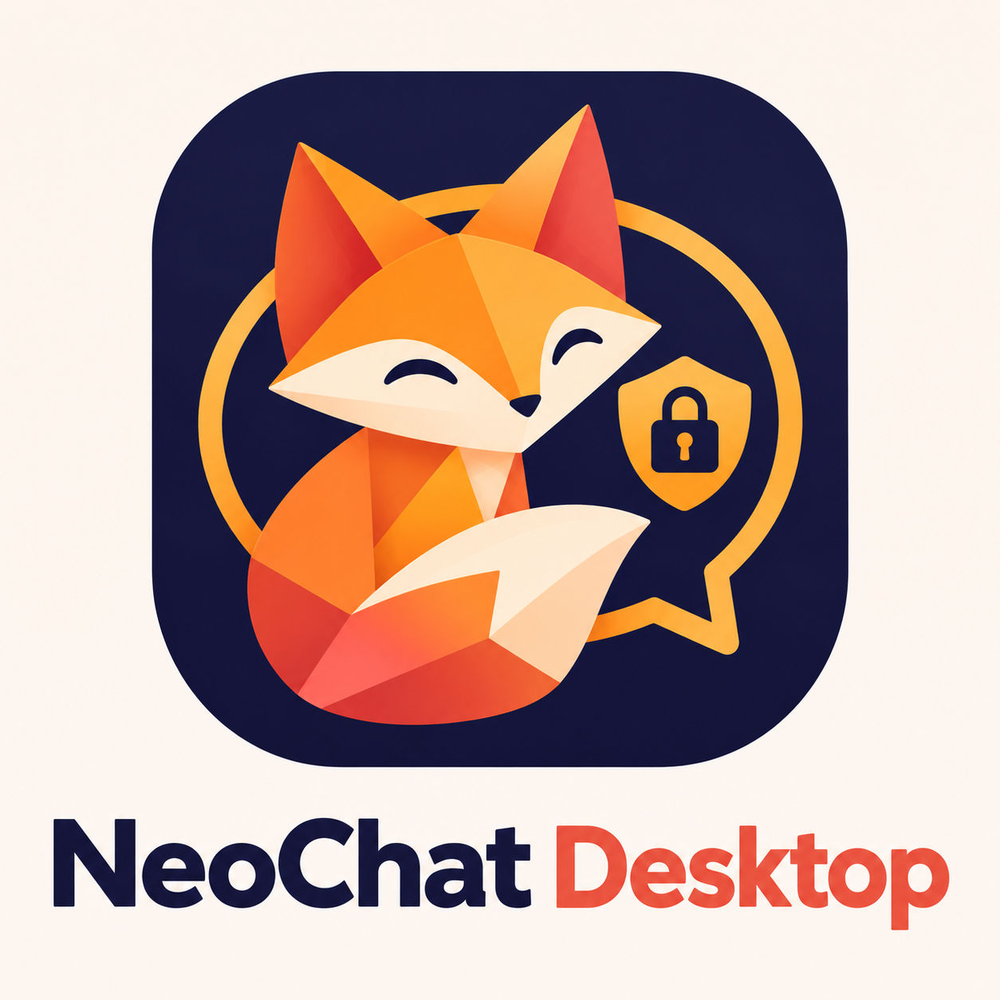

# NeoChat Desktop

[Português](README.pt-BR.md) · [Français](README.fr.md)



A desktop AI workspace for Windows, macOS and Linux. Use cloud providers or local models, work with files and tools, and organize conversations in one place.


## Features

- **Models:** Groq, OpenAI, Anthropic, DeepSeek and other providers; Ollama, LM Studio and OpenAI-compatible endpoints; provider fallback.
- **Agents and tools:** Neo Agent runtime with tool approvals, file checkpoints and undo; multi-agent teams; local and remote MCP servers.
- **Knowledge:** local document indexing and search, knowledge graph, persistent memory, projects and conversation branching.
- **Workspace:** document canvas with Word/PDF export, terminal, file explorer, browser, background tasks and Git integration.
- **Multimodal:** image input and generation, screenshots, voice transcription and text-to-speech.
- **Automation and integrations:** workflows, scheduled runs and Google Workspace connectors.
- **More:** model comparison, live sandbox, Podcast Studio, usage and cost tracking, and User and Power User interface modes. Open the global popup with `Ctrl+G` / `Cmd+G`.

## Getting started

Requirements: Node.js 22 or later and [pnpm](https://pnpm.io/) 10.9.0.

```sh
pnpm install
pnpm dev
```

In Settings, add a provider API key or configure a running local server such as Ollama or LM Studio. If Electron fails to install, run `pnpm approve-builds` and approve the required build scripts.

```sh
pnpm test    # Core tests
pnpm build   # Build the renderer
pnpm dist    # Package for the current platform in release/
```

## Credits and license

NeoChat Desktop builds on [groq-desktop-beta](https://github.com/groq/groq-desktop-beta) by Groq, Inc. See [LICENSE](LICENSE) for the MIT license.
